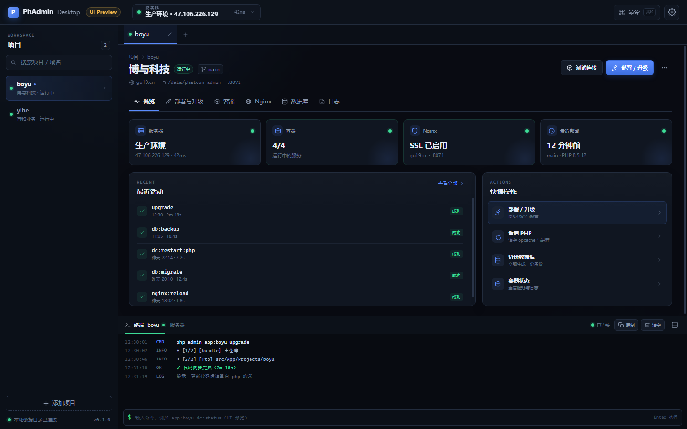

# PhAdmin Desktop

Phalcon Admin 的主机侧部署控制台，使用 Tauri 2 + Rust + React + TypeScript + SQLite 构建。

> 当前状态：静态 UI + SQLite 只读/导入 + 任务执行/历史/日志 + 真实容器状态与操作 + 白名单终端 + 多步骤部署编排 + 本地 git sync_items（legacy upgrade / compose / nginx / restart）已实现；远程/bundle/ftp 同步与配置渲染尚未接入。



## 目标

- 多服务器、多项目部署管理（`server × project`）
- 部署 / 升级 / 重置 / Docker / Nginx / 数据库备份 / SSL
- SQLite 管理配置、部署关系、运行历史
- 终端流式输出、任务取消、日志归档
- 最终替代仓库根目录的 `php admin`

`php admin` 在过渡期保留为迁移来源、差分验收 oracle 和应急回退路径。

## 导入 legacy 配置

在 legacy 仓库生成 JSON：

```bash
php admin config:export
```

打开应用 → 设置 → 导入 legacy 配置 → 选择 `deploy/.cache/config.json`。

- 导入写入本地 SQLite，不连接服务器；
- 重复导入按 `(server, project)` 幂等更新；
- 密码/密钥类 env 只记录“需要密钥”，不写入明文。

## 快速开始

```bash
npm install
npm run tauri dev
```

其他命令：

```bash
npm run typecheck
npm run build
npm run tauri build
```

Rust 检查：

```bash
cd src-tauri
cargo fmt --check
cargo clippy -- -D warnings
cargo test
```

## 文档

- [docs/README.md](docs/README.md) — 文档索引
- [docs/architecture.md](docs/architecture.md) — 总体架构
- [docs/data-model.md](docs/data-model.md) — SQLite 数据模型
- [docs/development.md](docs/development.md) — 开发指南
- [docs/roadmap.md](docs/roadmap.md) — 路线图
- [docs/ui-preview.md](docs/ui-preview.md) — 界面设计稿

## 目录

```text
src/           React + TypeScript 前端
src-tauri/     Rust + Tauri 后端
docs/          设计与开发文档
```

## Legacy

旧部署工具与配置：

```text
D:\demo\code\flutter\library\projects\phalcon-admin
```

迁移入口：

```bash
php admin config:export
```

在桌面端稳定并完成验收前，不要删除 legacy `deploy`。
